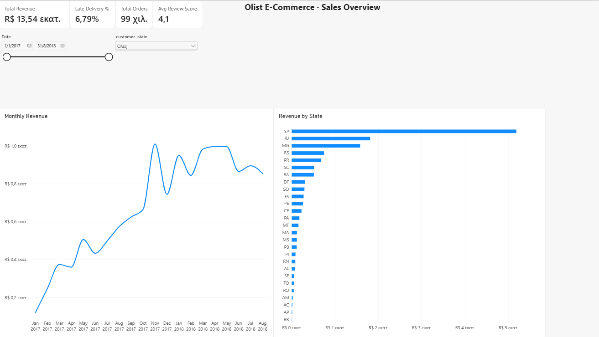

# Olist E-Commerce Sales Dashboard (Power BI)

An interactive Power BI dashboard on ~99,000 real orders from Olist, a Brazilian e-commerce marketplace (Jan 2017 – Aug 2018). The data is cleaned and modelled in Python (pandas), then analysed in Power BI with DAX measures.



## Business questions

1. How did revenue and order volume develop month by month?
2. Which product categories and states bring in the most revenue?
3. How reliable is delivery, and does a late delivery hurt customer satisfaction?
4. How do customers pay?

## Key findings

| Metric | Value |
|---|---|
| Revenue (product sales) | R$ 13.5M |
| Orders | 99,092 |
| Average order value | R$ 137.7 |
| Unique customers | 95,774 (only 3.1% ordered more than once) |
| Delivered late | 6.8% of delivered orders |
| Average delivery time | 12.1 days |

- **Late deliveries destroy satisfaction:** on-time orders average **4.3 / 5** stars, late orders only **2.3 / 5**.
- **Revenue peaked in November 2017** (Black Friday) at R$ 1.0M in one month.
- **São Paulo state alone brings 38% of revenue**; SP, RJ and MG together bring 63%.
- **Top categories:** health & beauty, watches & gifts, bed/bath/table.
- **75% of orders are paid by credit card**, 20% by boleto (Brazilian bank slip).
- **Almost no repeat customers (3.1%)**: retention is the clearest growth opportunity.

## Dashboard pages

| Page | What it shows |
|---|---|
| Overview | KPI cards (revenue, orders, AOV, avg review), monthly revenue trend, revenue by state |
| Products | Revenue by category, items sold, average price per category |
| Delivery & Satisfaction | Late-delivery rate over time, delivery days by state, review score for on-time vs late orders |

Slicers for date range, state and category work across all pages.

## How it was built

1. **Data preparation (Python, pandas)** – [`prepare_data.py`](prepare_data.py)
   - Joins 7 raw tables (orders, items, customers, products, reviews, payments, category translation)
   - Keeps full months only (Jan 2017 – Aug 2018), translates categories to English
   - De-duplicates reviews (one per order) and picks the main payment type per order
   - Calculates delivery days and a late-delivery flag
   - Exports two clean tables: `orders.csv` (one row per order) and `order_items.csv` (one row per item)
2. **Data model (Power BI)** – star schema: `orders` and `order_items` related on `order_id`, plus a `Calendar` date table
3. **DAX measures** – see [`dax_measures.md`](dax_measures.md)
4. **Report** – 3 pages with cross-filtering slicers

## Repository structure

```
olist-sales-dashboard/
├── prepare_data.py          # cleaning & feature engineering (pandas)
├── dax_measures.md          # all DAX measures used in the report
├── olist_dashboard.pbix     # Power BI report
├── data/processed/          # clean tables loaded into Power BI
└── images/                  # dashboard screenshots
```

## Run it yourself

```bash
pip install -r requirements.txt
python prepare_data.py        # downloads the raw data and writes data/processed/
```

Then open `olist_dashboard.pbix` in Power BI Desktop (free).

## Data source

[Olist public e-commerce dataset](https://github.com/olist/work-at-olist-data) (MIT License). Revenue is product price excluding freight.

---

**Dimitrios Giannatos** · [LinkedIn](https://www.linkedin.com/in/jim-gtos) · [GitHub](https://github.com/Gt0s)
